# Refund Shark

Refund Shark turns vendor agreements, customer outage evidence, and invoices into service-credit requests for finance to review. It scans configured accounts, names missing evidence, shows the quoted clause and calculation behind every amount, and prepares a draft after a person accepts the proposal. The vendor decides whether to award the credit. Submission and credit tracking are simulated.

**Models read; code decides.** A language model may extract contract terms into a typed schema with a quote for every field. Deterministic Python checks the quotes, applies the rules, and does all arithmetic. Missing evidence produces *needs review*, never a guess.

[Architecture, tool choices, and tradeoffs](docs/SUBMISSION_ARCHITECTURE.md)

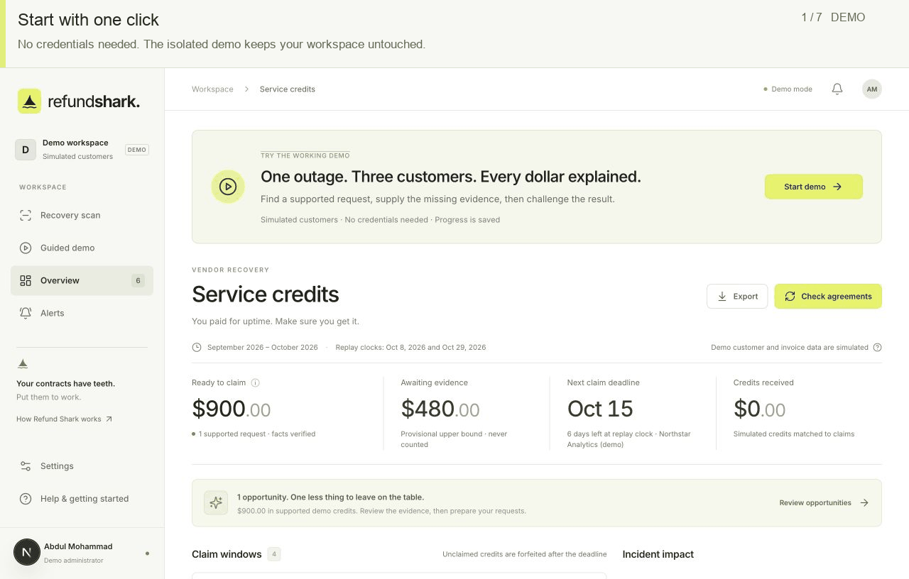

Captured app screens, condensed into 28 seconds. All customer evidence shown is simulated. [Still image](docs/screenshots/portfolio-guide.jpg) · [Demo narration](docs/DEMO_SCRIPT.md) · [Questions to rehearse](docs/JUDGE_QA.md)

**Full demo video:** [Standard app walkthrough](docs/demo/refund-shark-standard-demo.mp4), about three minutes of actual clicks and scrolling through the recovery scan, claim challenges, PDF review, contract citations, Datadog setup, and invoice matching. The recording is silent for the creator's voice-over; [timed narration notes](docs/demo/STANDARD_VOICEOVER.md) follow the workflow.

## Two-minute tour

1. `make setup`, then `SHARK_WATCH_INTERVAL=0 SHARK_MONITOR_INTERVAL=0 make demo`. Open http://127.0.0.1:3000 and click **Start demo**, or go directly to `/?view=recovery&demo=portfolio`.
2. The isolated portfolio opens with three prompts: compare outcomes, add the missing evidence, and review then challenge. It starts a new replay only if none exists; returning preserves progress. Use **Reset portfolio replay** for a fresh presentation. Northstar supports $900, Harbor needs a support ticket, and Cobalt's confirmed maintenance is excluded. The clock is explicitly October 8; these are not claims that can still be filed today.
3. Click **Add Harbor's missing ticket**. Its evidence now supports $480 and the total awaiting review rises from $900 to **$1,380**. Cobalt remains ineligible. No saved case changes just because evidence arrived.
4. Click **Review Harbor's request**, inspect **Prepared request and calculation**, check the review box, and **Accept proposal and prepare draft**. **Challenge saved draft** opens the saved $480 draft that still requires approval. Its amount leaves the awaiting-review total to prevent double counting.
5. Try **Remove the support ticket** under **Challenge this claim**. The same engine changes the supported amount to $0 and shows the missing prerequisite and original clause. Try **Import the same evidence twice**: overlapping minutes count once, so the amount stays $480. The saved draft is unchanged.
6. **Download evidence bundle**. From this checkout run `uv run python -m shark.bundle verify /path/to/download.zip`. It checks the files and reproduces the amount offline from the bundled logs, terms, and clock.

For the full outage-to-invoice-credit story, open **Guided demo** (`/?view=demo`). Its separate five-step replay reaches a $900 claim and matching invoice credit. Both replays have safe reset buttons and preserve the ordinary workspace. A [narrated demo script](docs/DEMO_SCRIPT.md) is included.

Any case prints as an evidence packet: the calculation, every quoted clause, and the draft.

## What is real and what is simulated

| Input | Status |
| --- | --- |
| Atlassian SLA (effective April 30, 2026) and Atlassian's compensation procedure | **Real.** Verbatim line excerpts in `data/sources/`, chained by SHA-256 to the pages retrieved on October 30, 2026 (UTC). Every cited term's quote is checked against this text. |
| Jira incidents of September 3 (`ws0393rxcgyl`) and October 21 (`1yh59bb4lw20`) | **Real** public Statuspage records: IDs, historical component updates, timestamps, links. Rebuilt from the update history, not current component status. |
| Customers, invoices, receiving invoices, request logs, support tickets, maintenance notice | **Simulated** and labeled in the UI, the API, the CSV export, and every drafted claim. The request logs are full per-minute logs for September (`data/fixtures/logs/`); the Downtime Minutes are computed from them by code, not typed in. |
| Customer directory (`data/fixtures/customers.json`): who pays which vendor for which plan, and where their site is hosted | **Simulated**, with the plan and site region that spend data alone does not show. It includes a Standard-plan customer (no SLA) and EU and APAC sites, so alerts have someone to leave out. |
| Ramp Developer API reference (`docs.ramp.com`) | **Real.** The spend import reads only fields this public reference documents; each one is cited by a verbatim line in `data/sources/ramp-developer-api.excerpt.txt`, hash-chained to the pages retrieved on October 31, 2026 (UTC). |
| Sample Ramp business, Lumen Freight (`data/fixtures/ramp/`) | **Simulated**, saved in the documented response shapes and imported through the same code that reads the live API. |
| GitHub and Cloudflare agreements | **Authored** boundary fixtures that show where the engine stops. They are not those vendors' terms. |
| Extracted term values for Atlassian Jira Premium | Entered by hand against the quotes. Not reviewed by a lawyer or independently checked as gold labels. |

Nothing is sent to a vendor, and no real money is involved.

## Quick start

Requirements: [uv](https://docs.astral.sh/uv/) (it installs Python 3.12) and Node.js 22 or later. Setup downloads dependencies. The saved demos need no API keys; disable polling as below for offline operation after setup.

```bash
make setup   # uv sync --frozen and npm ci, from the lock files
make demo    # API on http://127.0.0.1:8000, app on http://127.0.0.1:3000
# Offline replay: SHARK_WATCH_INTERVAL=0 SHARK_MONITOR_INTERVAL=0 make demo
```

Open http://127.0.0.1:3000. `?case=<id>` opens a case directly, e.g. `/?case=jira-sept-claim`. Set `SHARK_API_PORT` / `SHARK_WEB_PORT` if those ports are taken. Ctrl+C stops both servers. Local state lives in `.cache/refund-shark.sqlite3`. Use the isolated replay reset buttons, or `SHARK_DB=.cache/new-workspace.sqlite3 make demo` for a separate workspace while preserving existing data.

## Recovery scan, challenges, and reproducible evidence

**Recovery scan** assembles proposals for completed invoice months across configured accounts. It matches confirmed invoice identities, measures saved request logs, checks ticket timing and human-reviewed facts, and separates ready, missing evidence, ineligible, and already handled cases. The open screen refreshes every eight seconds; it is not a background filing service. Ambiguous invoices, duplicate setups, conflicting logs, unsupported agreements, and unknown prerequisites cannot become ready proposals. New measurement evidence requires renewed fact review. Explicit acceptance creates or updates the monthly draft and invalidates any earlier approval; submitted cases stay locked.

**Challenge this claim** offers seven isolated changes: missing or late ticket, excluded maintenance, expired filing window, duplicate evidence, missing logs, and a broken citation. It invokes the production engine on a copy and shows the changed checks beside the original clauses.

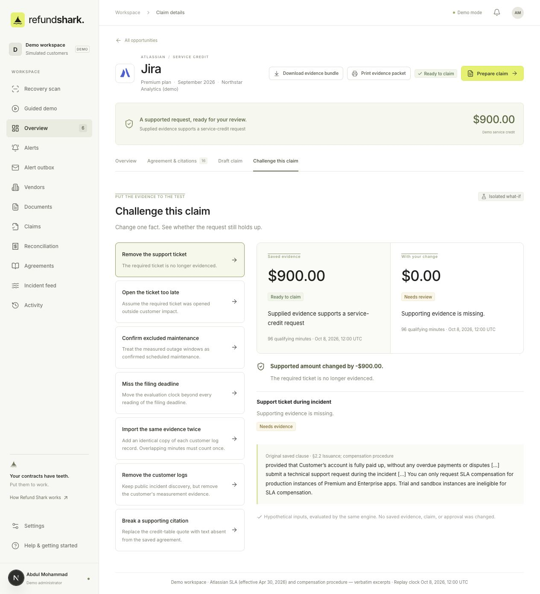

**Evidence bundles** include selected source logs, available linked PDFs, agreement text, terms, decision, draft, and a SHA-256 manifest. The verifier remeasures the logs and reproduces the complete decision without network calls. It rejects altered files, unsafe archives, incompatible engine versions, and calculation differences. Use the checkout that produced the bundle. Integrity is not proof of source authenticity or vendor acceptance; legacy fixtures explicitly report when original PDFs are unavailable. See [integration details](docs/INTEGRATIONS.md).

**Reference review:** an [AI-assisted audit of all 16 Jira fields](docs/AI_REFERENCE_REVIEW.md) corrected requester authorization, incomplete exclusions, and an unsupported form-field list in the demo terms. The original evaluation inputs and results are preserved. A person's review remains pending; no extraction-accuracy result is claimed. Follow [the reference-review instructions](docs/EVALUATION_REVIEW.md).

## The demo cases

The new **Documents → Vendors → Evidence → Alert outbox → Reconciliation** workflow connects uploaded files to the existing claim engine. See the [complete walkthrough and integration setup](docs/INTEGRATIONS.md).

For the quickest demo, open **Guided demo** (`/?view=demo`). Five clicks take a simulated subscription from outage detection through a support ticket, 62 measured downtime minutes, a $900 claim, and the matching invoice credit. **Reset walkthrough** starts a new isolated replay and preserves workspace documents, vendors, and claims. It needs no credentials or paid model calls.

- **Contract review:** edit extracted values alongside their source and approve a numbered version with a reviewer and reason. Original extractions and existing cases remain pinned. Unknown terms still require review; a human approval never overrides a failed quote check or unsupported metric.
- **Monthly cases:** combine selected logs and support tickets for one company/account/product/month. Identical overlapping rows count once, conflicting counts are refused, and repeat requests reuse the case. Explicit evidence updates preserve the prior revision and invalidate earlier approval. Submitted user cases are locked against replacement or deletion; duplicate active claims are blocked. Bundled example cases remain separate demonstrations.
- **Incident actions:** alerts now show the affected subscription, responsible person, vendor support link, prepared ticket, and a place to record the actual support-ticket reference. Customer impact boundaries remain separate from the public status timeline.
- **Datadog connector:** import account-scoped request/error count metrics through the read-only timeseries API. One-minute buckets, missing-data checks, saved source mappings, manual sync, and optional background ingestion feed the evidence inbox. Credentials stay on the server. Live access has not been exercised; tests use mocked responses.

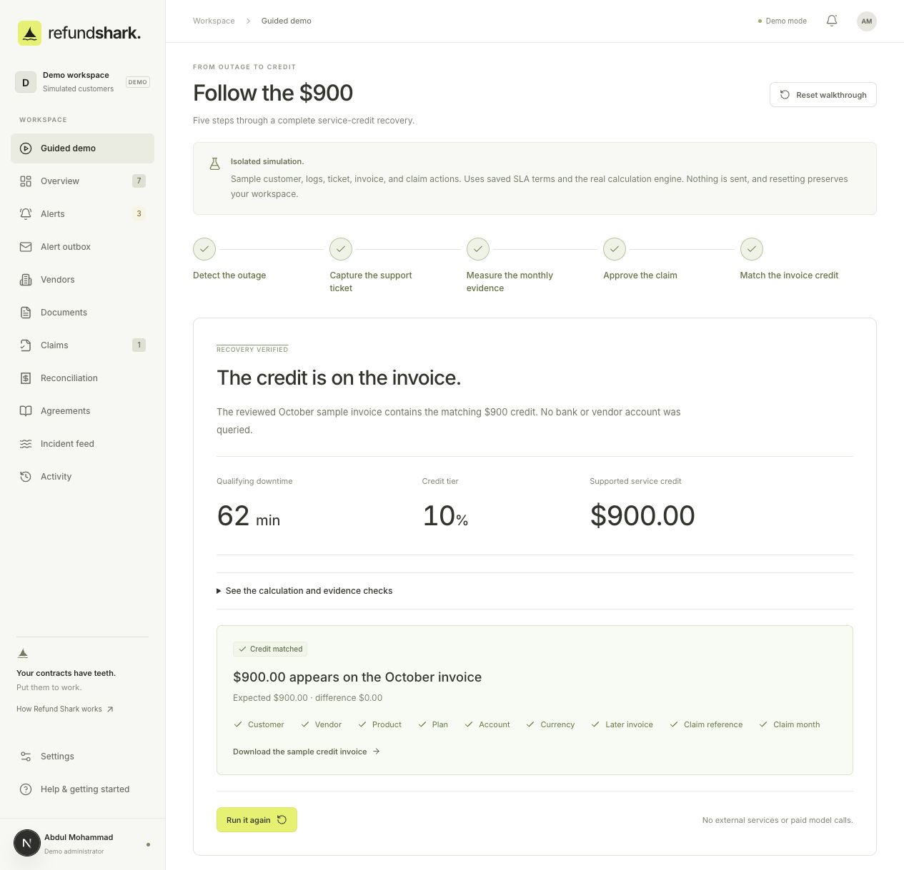

- **PDF documents:** upload searchable contracts and invoices, retain their originals and text by page, and read contracts with page citations. Invoice suggestions require human confirmation; ambiguous values are left for review. Simulated sample PDFs are included.
- **Vendor setup:** link the right company, product, plan, account, region, agreement, invoice, and owner. A four-step checklist shows what is still missing. Saved subscriptions participate in the supported outage feeds.
- **Evidence inbox:** persist customer request logs and support-ticket references, or ingest them through an authenticated monitoring/support export API. Build a new case from this evidence without changing earlier approvals.
- **Alert outbox:** preview and download owner-addressed email drafts. Optional SMTP and Slack delivery requires server configuration and explicit review of each message. Retired incidents and reassigned owners supersede stale drafts; ambiguous delivery failures are never automatically retried.
- **Invoice reconciliation:** compare a supported, submitted demo claim with a confirmed later invoice. Report a full match, partial credit, missing credit, excess credit, or identity mismatch. This verifies supplied invoice data; it does not query a bank or vendor account or change the simulated claim state.

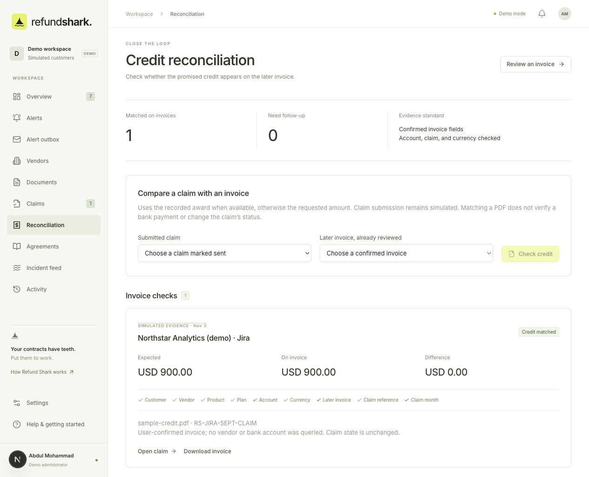

All Atlassian cases are Jira Premium and cite the same real agreement. Each case is evaluated at a labeled **replay clock**. The UI and API also show a read-only result at today's date, which never changes stored claims.

| Case | Inputs | Result at the replay clock | At today's date |
| --- | --- | --- | --- |
| **Claim candidate** `jira-sept-claim` | Real Sept 3 US East incident; a simulated per-minute request log (129,600 rows) from which code computes 96 Downtime Minutes on View Issue and Edit Issue; simulated $9,000 invoice, receiving invoice, and support ticket | **Ready to claim: $900.00.** 96 of 43,200 minutes gives 99.778% uptime, which falls in the 10% tier. Draft, approve, mark sent, and match a simulated credit. | Not eligible: the September window closed in mid-October |
| **Missing evidence** `jira-sept-missing-evidence` | The same real incident, with no customer logs, support ticket, or receiving invoice | **Needs review.** The missing inputs are named. Provisional estimates: the status-update window (38.43 min) reaches no tier ($0.00); the vendor's postmortem window (130 min) would be 10% ($480.00), shown as an upper bound and never counted. | Not eligible: window closed |
| **Refusal** `jira-sept-maintenance` | A simulated per-minute log: 75 Downtime Minutes, all inside a confirmed scheduled maintenance window | **Not eligible.** The SLA's §3(f) excludes scheduled maintenance; counted downtime is 0. | Not eligible: window closed |
| Current period `jira-oct-degraded` | Real Oct 21 sidebar incident, reported as *degraded performance*; October still open | **Needs review.** Degraded status is not counted as an outage, and the period has not ended. | Needs review (until the window closes) |
| Boundary `github` | Authored quarterly agreement | **Needs review**, unpriced: quarterly measurement has no adapter yet | Needs review: evaluation stops at the unsupported period |
| Boundary `cloudflare` | Authored visitor-ratio agreement | **Needs review**, unpriced: affected-visitor data is required | Needs review: evaluation stops at the unsupported metric |

After a claim is marked sent, **record what the vendor awarded**. A short award opens Atlassian's revisit window, "3 business days to request that we revisit the claim", counted Monday to Friday from when the award is recorded (earliest and latest readings, since the procedure names no time zone), with a revisit request drafted by code; after the window it is refused. Accept the award to close the claim.

Every claim keeps a history (drafted, redrafted, approved, sent, award recorded, revisit requested, credited, invalidated) tied to the hash of the decision it was approved against, and **Print evidence packet** turns the case into a printable packet with the calculation, every quoted clause, and the draft.

Each case shows a **downtime budget** (counted minutes against the allowance and the credit tiers, with provisional windows as markers that are never filled in) and a **timeline** of the counted minutes against the vendor's own windows. In the claim case the customer's errors begin 53 minutes before the vendor's status page reported an outage.

| Claim candidate | Missing evidence | Refusal |
| --- | --- | --- |
| 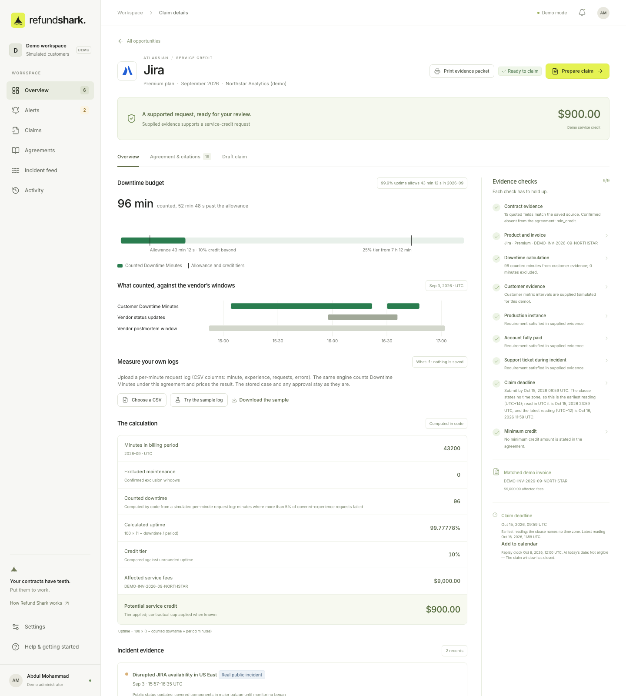 | 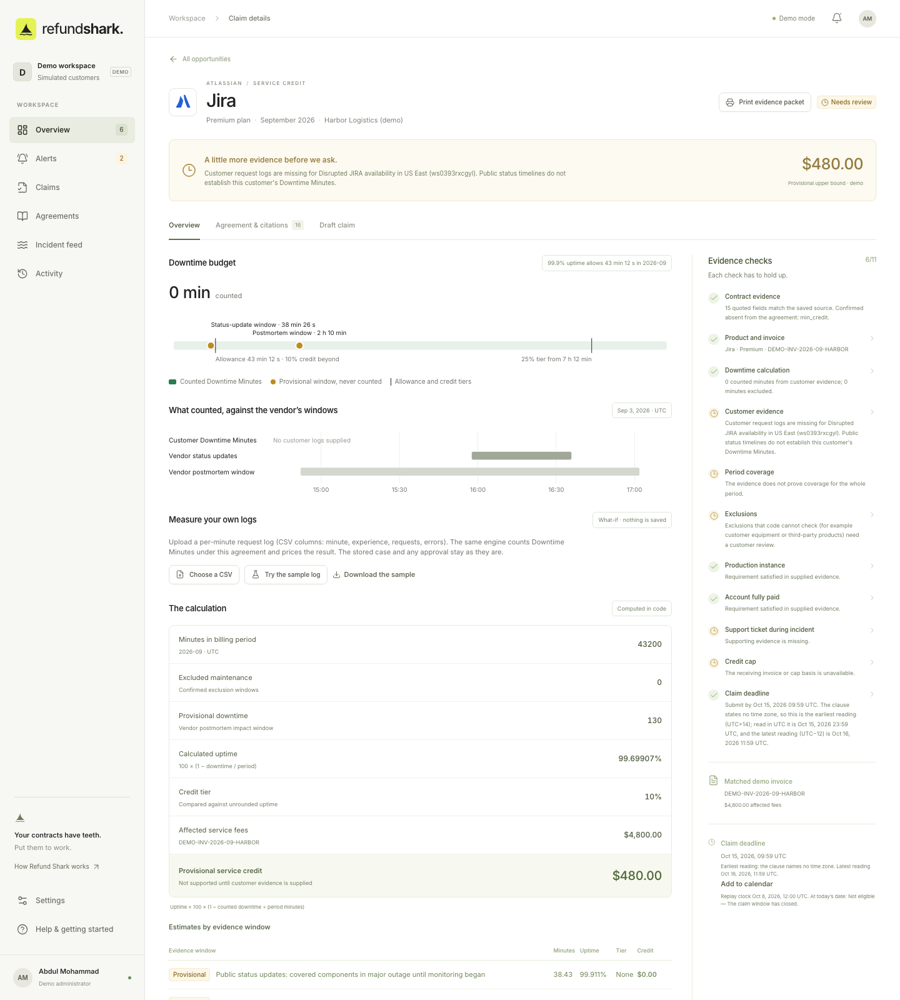 | 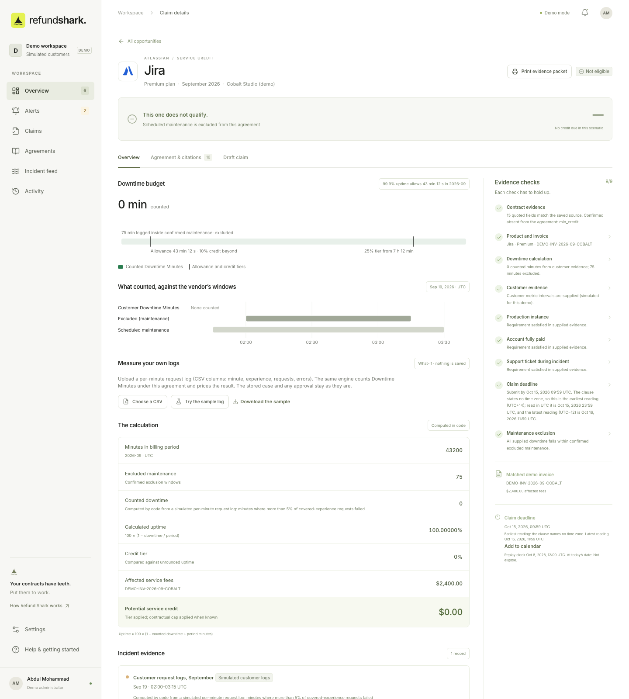 |

| Read an agreement | Live status |
| --- | --- |
| 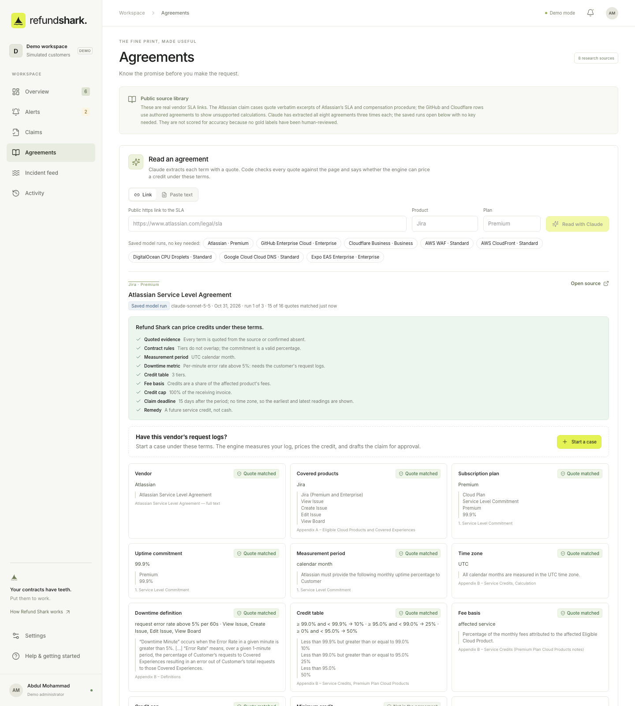 | 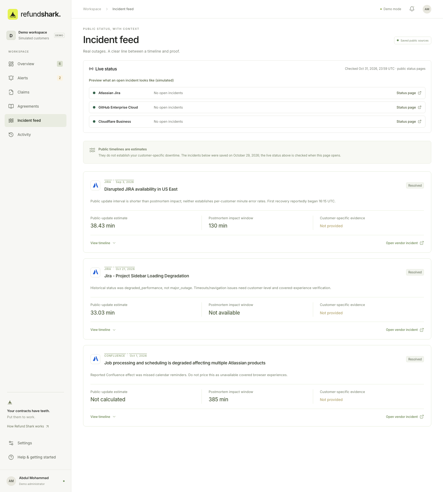 |

## Outage alerts, while a ticket still counts

Atlassian's credit depends on "a technical support request during the incident". Once the outage ends, that prerequisite can no longer be met, so Refund Shark watches for outages instead of waiting for the month to close.

1. **Notice.** While the API runs, a background watcher polls the public status pages for Jira, GitHub, and Cloudflare (every 2 minutes under `make demo`; `SHARK_WATCH_INTERVAL` sets it, `0` turns it off; `shark watch` runs it from the command line). Each incident is recorded once. An unreachable feed resolves nothing.
2. **Narrow.** Each customer is matched by three rules (`shark/incidents/matching.py`): does their plan have an SLA, did the incident name their site's region, and did it touch a covered feature? The result is *affected*, *possibly affected* (the incident or the site region is unknown), or not alerted, with the reason: other region, not a covered feature, or no SLA on the plan.
3. **Alert.** Matched customers get an in-app alert with the agreement's requirement quoted and a support ticket written by code, ready to paste. When the incident resolves, each of them gets a follow-up with the filing deadline (for October, Nov 15, 2026, 09:59 UTC, the earliest reading).

**Run a simulated outage** on the Alerts page sends a labeled drill through the same path: the two bundled US East customers on an SLA plan are alerted, and the EU, APAC, and Standard-plan customers are listed as not alerted, each with its reason. Subscriptions configured in Vendors join this matcher. Alerts remain local unless a person configures delivery and explicitly sends a reviewed message from the Alert outbox.

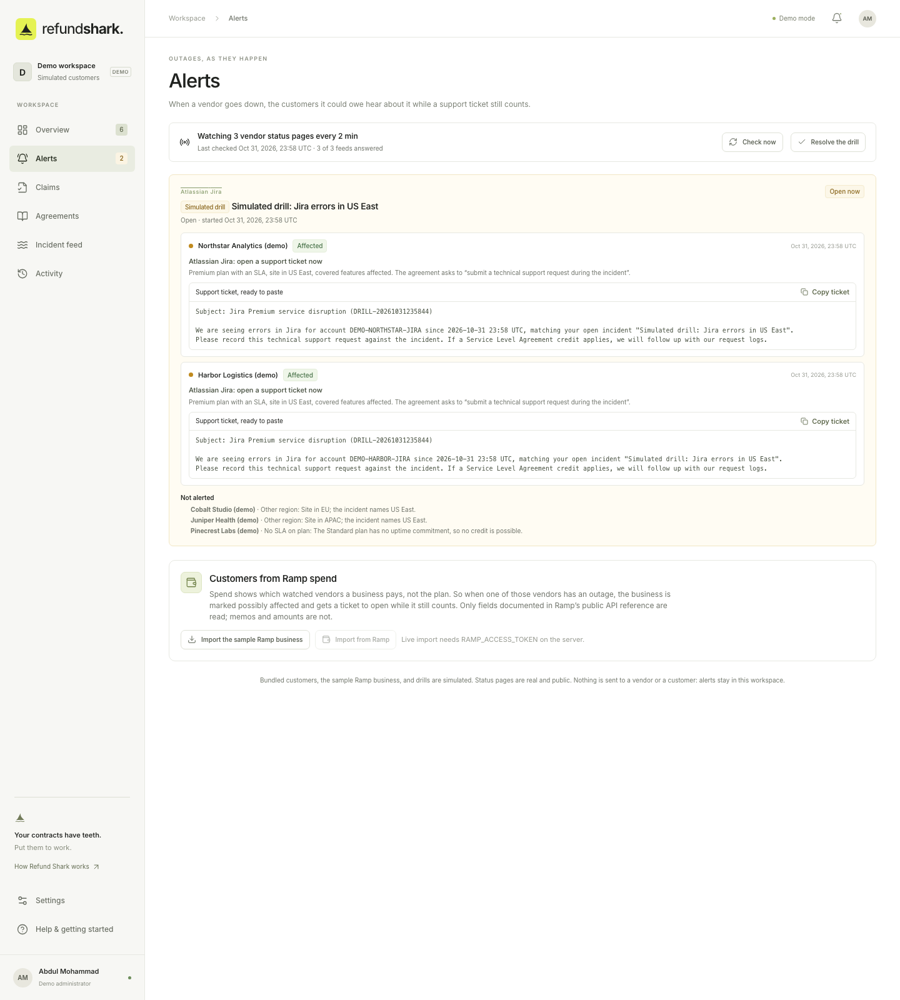

## Measure your own logs

Every case whose agreement counts per-minute request errors has an upload panel. Upload a CSV with the columns `minute,experience,requests,errors`, one row per minute and experience. `POST /api/opportunities/{id}/logs/analyze` runs the same analyzer, swaps the result into a copy of the case, and prices it with the real `evaluate()`. Nothing is stored, so an upload can never invalidate a stored approval. A simulated September sample is served at `/api/logs/sample.csv`: 62 Downtime Minutes on View Issue during the Sept 3 incident. On Harbor's case it clears the "request logs are missing" blocker and shows $480 counted, still pending the support ticket, the receiving invoice, and an exclusions review. Raw request events are not parsed; aggregate them to per-minute counts first.

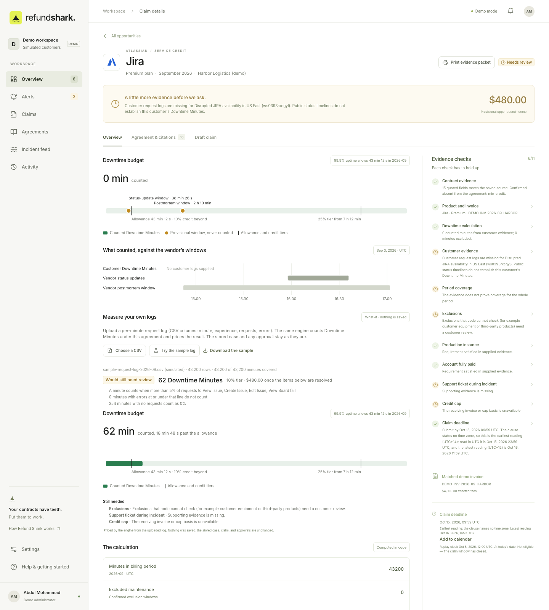

## Never miss a claim window

Credits are forfeited when nobody files in time. Atlassian's window closes fifteen days after the month ends. The overview leads with what is at stake:

- **Claim windows**, soonest first: file a supported claim, or collect the named evidence (request logs, a support ticket, the receiving invoice) before the earliest deadline reading.
- **Incident impact**: one public outage, every account it touches. The real Sept 3 Jira outage maps to two demo customers: $900 ready to claim, and up to $480 if the second customer's logs confirm the downtime.
- The headline total counts only supported credits; provisional upper bounds are shown separately and never added in.
- **Add to calendar** on any case downloads the claim deadline as an `.ics` event (with a reminder a day before), at the earliest reading when the clause names no time zone.
- **Live status**: the incident feed checks the real public status pages for Jira, GitHub, and Cloudflare when it opens. Atlassian's procedure asks for "a technical support request during the incident", a prerequisite that is gone once the outage ends, so an open incident brings up that quote and a paste-ready ticket for each affected customer, rendered by code. An unreachable feed reads as unknown, never as healthy. A clearly labeled simulated preview shows the flow when nothing is open.

## Read any agreement

The Agreements page reads a new SLA: paste a public https link or the text, name the product and plan, and Claude extracts each term with a quote. Code then checks every quote against the page, marks each term quoted, absent, missing, or unverified, and reports whether the engine could price a credit under those terms. Unsupported periods or metrics are named, not guessed. The eight catalog agreements open from one-click chips showing their saved model runs, with no API key needed (`/?view=agreements&read=atlassian` opens one directly). Fetching is limited to https pages on public addresses: localhost, private ranges, and cloud metadata addresses are refused, including after redirects.

## Start a case from any agreement

A reading becomes a case. Under any agreement read on the Agreements page, **Start a case** opens a form generated from that agreement's own terms: one question per prerequisite it states (for Atlassian: a support ticket during the incident, an account paid up, a production instance, an authorized requester), the billing period and fee, monthly or annual billing, and a per-minute request log. `POST /api/cases` measures the log under the agreement's definition, stores the case beside the demo cases, and prices it with the same `evaluate()`; it survives a restart and can be drafted, approved, or deleted. The form refuses a prerequisite the agreement doesn't name and a log the agreement's metric can't measure (only per-minute request-error agreements can be measured from a log today). Records you enter are labeled *provided by you*; a case built on the sample log is labeled simulated throughout. A pasted agreement's terms are quoted from the text you pasted; a saved run is checked against the full page when it is cached, and otherwise against the committed verbatim excerpts, which is how a fresh clone starts the Atlassian case with no key. Claim forms whose fields the agreement doesn't enumerate draft with a note to complete them; a named field the drafter can't fill still refuses.

| The form, from this agreement's own terms | The stored case |
| --- | --- |
| 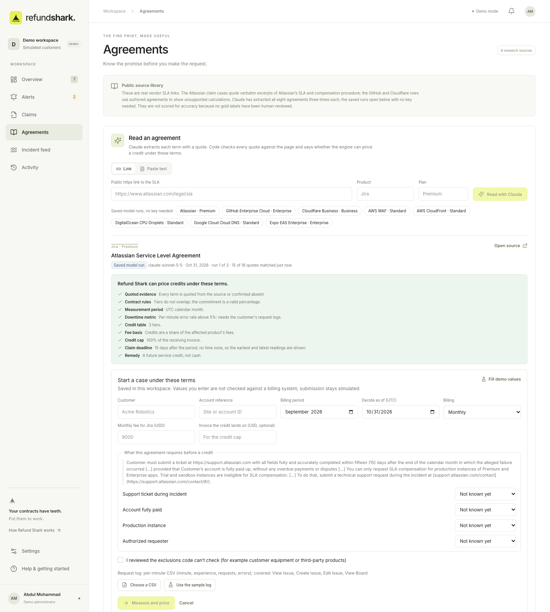 | 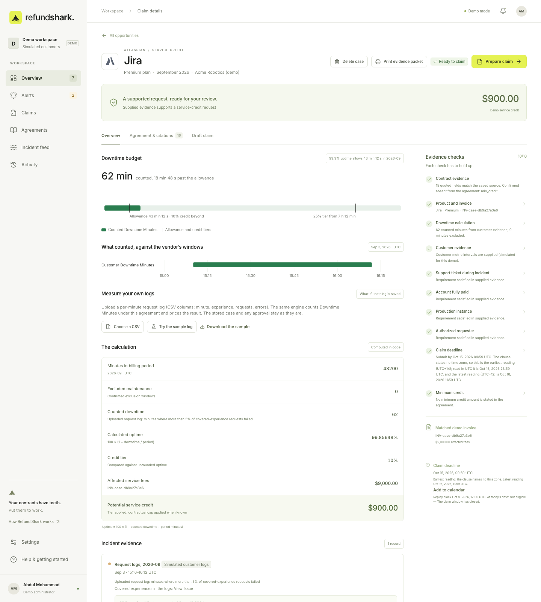 |

## Customers from Ramp spend

The alert matcher needs to know who pays which vendor. **Import the sample Ramp business** (or **Import from Ramp** with `RAMP_ACCESS_TOKEN` set on the server; scopes `business:read transactions:read vendors:read`, production or sandbox via `RAMP_ENVIRONMENT`) reads three endpoints of Ramp's Developer API: the business name, vendors (name, active, `billing_frequency`), and transactions (`merchant_name`, `state`, `user_transaction_time`), following `page.next` only on Ramp's API host. Every field read is registered in `shark/spend/ramp.py` with the verbatim line of the public reference that documents it, and reading any other field raises; a test checks each line against the committed excerpt, and `make verify-sources` checks the excerpt against the cached docs.

Spend shows that a business pays Atlassian, not which product or plan, and memos and merchant descriptors are never read to guess one. So an imported customer gets a subscription with the plan *unknown*. An outage makes them *possibly affected* (never *affected*, never dropped), the alert says the plan must be confirmed, and the ticket names no plan. Importing while an incident is open alerts the new customer immediately. Amounts are not read, because the reference does not state the unit of a transaction amount; the import reports charge counts, the latest charge, and the billing frequency instead.

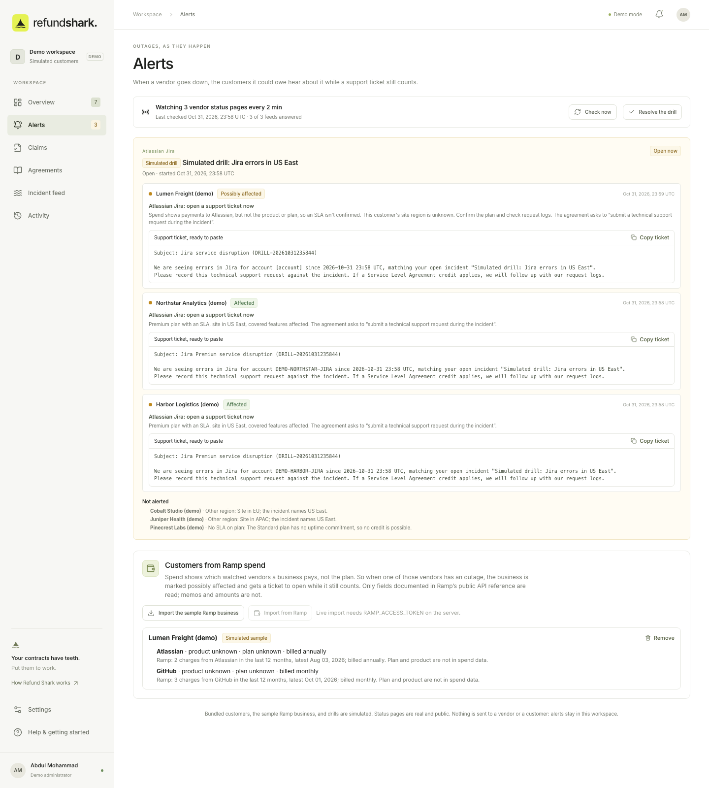

## How a decision is made

```text
public page ─► verbatim excerpt ─► cited terms ─► quote + rule checks
                                                        │
customer metrics (counted) ─┐                           ▼
public incidents (estimate) ┼──────► deterministic engine ─► decision + checks + calculation
invoice + account context ──┘                           │
                                                        ▼
                                  claim draft (facts rendered in code) ─► human approval ─► simulated sent / credit match
```

What the engine (`shark/engine/decision.py`) enforces:

- **Each term is in one of four states**: *verified* (quote found), *unverified*, *missing* (not extracted), or *absent* (the agreement states no such term). A confirmed absence means "no minimum" or "no cap". A missing or unverified term sends the decision to review (`shark/extract/citations.py`). A quote may join verbatim fragments with `[…]`, and every fragment must appear in the source.
- **Downtime Minutes come from raw request logs.** `shark/engine/metrics.py` applies the SLA's definition minute by minute: a minute counts only when more than 5% of the customer's requests to covered experiences fail, a minute with no requests is 0%, and API or integration traffic is not covered. Its tests are the SLA's own worked examples (100 of 100, 10 of 100, 1 of 100, no requests), plus the exact 5% boundary. Logs are pinned by SHA-256 and re-analyzed on every load; logs that do not cover the whole month send the case to review. The demo log includes a minute at exactly 5.0% (not counted) and 132 REST API error minutes (excluded).
- **Public timelines never count as contractual downtime.** Atlassian measures per-minute customer request error rates on covered experiences. Customer metrics produce counted minutes. A public incident without them produces review and separate, labeled estimates for each documented window.
- **No rounding before comparisons.** Tier boundaries compare cross-multiplied Decimals, with explicit `<`/`<=` semantics. Intervals are merged, clipped to the UTC calendar month, and have confirmed maintenance subtracted.
- **Deadlines without a time zone** are not guessed. Atlassian's clause gives "fifteen (15) days after the end of the calendar month" with no zone, so the engine computes the earliest (UTC+14) and latest (UTC−12) readings. Before the earliest, the claim proceeds and the UI explains the reading. Between the two, it needs review. After the latest, the window is closed.
- **Caps and prices follow the agreement.** The cap is applied against the receiving invoice. Annual billing is priced only when the agreement says how ("your service credit will be based on your annual fee (adjusted for amount per month)": the annual fee ÷ 12), and goes to review without the annual fee or that rule. A credit that rounds to $0.00 is refused. Bundled SKUs, non-USD currency, quarterly periods, and unsupported metrics go to review.
- **Prerequisites have three states**: satisfied, known failed (not eligible), or unknown (review).
- **Claims are rendered from the decision.** Optional opening text is filtered so it cannot add numbers or change the remedy. A changed decision invalidates any approval, reruns are idempotent, and a credit only matches on customer, vendor, service, period, currency, reference, and exact amount.

## Commands

| Command | What it does |
| --- | --- |
| `make test` | 318 pytest cases covering the engine, evidence/citations, extraction guards, API lifecycle, PDF review, monthly deduplication, Datadog mappings, reconciliation, isolated replays, recovery scan, claim challenges, and bundle integrity; private-source checks skip when their raw snapshots are absent |
| `make eval` | Offline fixture checks plus the live-extraction report (see below); writes `.cache/eval/latest.json` |
| `make check` | Tests, eval, and the TypeScript type check |
| `make build` | Production Next.js build, including TypeScript validation |
| `uv run python -m shark.bundle verify /path/to/claim.zip` | Verify evidence hashes and reproduce the saved decision offline |
| `uv run python -m eval.review_labels prepare` | Prepare a human reference worksheet from the original cached Jira source; review before running `score` |
| `uv run python -m eval.review_labels audit data/reviews/atlassian-jira-premium.ai-proposed.json` | Reproduce the AI-only reference diagnostic; requires the original cached source, leaves human review pending, and makes no accuracy claim |
| `make smoke` | Builds the web app and checks eleven pages in headless Chrome against a throwaway database: the overview, all three outcomes, agreements, live status, the log what-if, alerts during a drill, starting a case, the stored case, and a Ramp import (run `make build` afterwards if you use `npm start`) |
| `make screenshots` | Same as `make smoke`, also writing `docs/screenshots/*.png` |
| `make fetch-sources` | Downloads the eight agreements (and Atlassian's compensation page) into dated folders under `.cache/sources/`, recording raw and text hashes |
| `make verify-sources` | Checks the committed excerpts (agreements and the Ramp API reference) against their recorded hashes, the recorded snapshot (if cached), and the newest download |
| `make fixtures` | Regenerates `data/fixtures/scenarios.json` from the excerpts and `docs/research/real-incidents.json` |
| `.venv/bin/shark run --vendor atlassian --product jira --plan premium --period 2026-10` | Evaluates matching bundled scenarios; add `--as-of 2026-10-29T12:00:00Z` or `--current` to change the clock |
| `.venv/bin/shark extract SOURCE.txt --service Jira --plan Premium` | Live extraction (needs `ANTHROPIC_API_KEY`); cached by source, model, prompt, and schema hash |
| `.venv/bin/shark watch [--once]` | Polls the vendor status pages and records alerts for the customers each outage could owe (what the API's background watcher does) |
| `.venv/bin/shark logs LOG.csv --experiences "View Issue,Create Issue,Edit Issue,View Board"` | Computes Downtime Minutes from any per-minute request log (`minute,experience,requests,errors`, CSV or gzip) |
| `.venv/bin/shark replay EXTRACTION.json SOURCE.txt` | Re-verifies a saved extraction against its exact source text |
| `.venv/bin/python scripts/run_extractions.py --split tuning` | Three live runs per tuning agreement into `data/extractions/`, stopping before estimated spend passes `--budget` (default $4.50); `--freeze` locks prompt, schema, and model before `--split held_out` |

The API is documented at http://127.0.0.1:8000/docs while the demo runs.

## Evaluation status

- **Offline fixture checks: 6 of 6 scenarios match** outcomes and amounts that were derived by hand from the quoted clauses (`make eval`). This tests the engine and fixtures. It does not measure extraction accuracy.
- **Live extraction: 24 runs, not yet scored for accuracy.** Claude (`claude-sonnet-5-5`, effort medium) extracted all eight agreements three times each: six tuning documents, then the configuration was frozen (prompt `cited-terms-v4`, schema hash, model) at 2026-10-31 01:57 UTC before one batch on the two held-out documents. The 24 runs cost about $1.30 (358K input and 59K output tokens at $2 and $10 per million); the discarded first probe added $0.07. Every run is saved in `data/extractions/`, the first tuning attempt is kept in `data/extractions/_tuning/`, and the full evaluator output, made with the raw pages cached, is `data/gold/eval-report.json`. In a fresh clone `make eval` re-checks everything that does not need the private raw pages. Accuracy is not reported because no gold labels have been reviewed by a person; what can be measured without them:

  | Measure | Result |
  | --- | --- |
  | Stated terms whose quote appears verbatim in the source | **296 of 300 (98.7%)**; the worst single run is 92% |
  | Runs agreeing on a term's material value (three runs per document) | 0.94 on Atlassian; 0.62–0.94 across documents. Lowest on Cloudflare (a visitor-ratio formula) and held-out Expo, whose credit table overlaps as written |
  | Engine could price credits under the extracted terms | Atlassian in 3 of 3 runs; every other agreement is held for review, with the blocking term named |
  | Atlassian, agreement with the unreviewed draft labels | 13 of 16 material terms in the worst run. On inspection, the source supports the model in all three differences: it found an "authorized requester" prerequisite the drafts missed, said the claim form's fields are not enumerated ("all fields fully and accurately completed"), and split exclusions the drafts lumped together. The draft labels were not edited after seeing these runs |
  | Atlassian decisions, extracted vs draft terms (4 scenarios × 3 runs) | **0 false positives.** 6 comparisons agree only because both paths return *needs review*; the other 6 move from a priced outcome to *needs review*, because the extra prerequisite has no evidence on file |

  The tuning pass changed three things after the first probe: the credit table came back empty, prerequisites and exclusions came back as free text the engine cannot act on, and the deadline's time zone was inferred from an unrelated clause. The fixes were fixed vocabularies, guidance on reading credit tables, and a rule that a deadline only has a time zone if its own clause names one. On held-out Expo, two of three runs resolved the overlapping credit table into clean tiers on their own, despite the prompt; the third kept the overlap, and the engine sent it to review. Eight documents is a small validation set, not a benchmark.
- **Structured outputs, in three parts.** Extraction uses the Anthropic Python SDK's structured outputs (`client.beta.messages.parse`). One schema for all sixteen terms compiled to a grammar the API rejected as too large, so each run makes three requests (commitment and measurement, pricing and exclusions, claim process) against a flat schema (`shark/extract/schema.py`). Code converts the result into `SLATerms`, where a value that fails validation becomes *missing* with a note. Server-side refusal fallback is on, and the answering model is recorded as `served_by`. The prompt treats the source as untrusted data.

## Scope and limitations

- One complete path: **Atlassian · Jira · Premium**, UTC calendar month, USD, one standalone product on monthly or annual billing. Other agreements are represented so that unsupported calculations go to review, not into a dollar amount.
- Atlassian's monitoring "is the sole source of truth". Refund Shark prepares a well-supported *request*; the vendor decides the credit.
- Request evidence uses per-minute counts. CSV upload, an authenticated push integration, and a native Datadog connector are available. Datadog mappings require human confirmation and live access remains untested; CloudWatch and raw-event aggregation are not built.
- Public status feeds expose only recent incidents, so an empty or partial feed is treated as unknown coverage, not 100% uptime.
- Alert matching relies on the region named in the incident's title or updates; when none is named, every customer on an SLA plan is "possibly affected". The bundled directory is simulated; Ramp-imported customers never have a known plan or region.
- The live Ramp import is written against the public reference and tested with recorded response shapes, but it has not been run against a real Ramp account (no token was available). It does not read bills, invoices, or amounts, so Ramp data never prices a credit.
- PDF invoices use conservative label-based suggestions and user review, not a general-purpose invoice extraction model. OCR for scans is not built. Reconciliation checks supplied document fields, not vendor/bank records.
- Not built: authentication, tenant isolation, and hosting. This remains a local workspace. A narrated walkthrough script is in `docs/DEMO_SCRIPT.md`; the video itself is not recorded. Optional prose generation for claims exists as a guarded hook but is not wired to a model.

## Repository layout

```text
shark/            engine, models, extraction (fetch, excerpts, citations, provider), Statuspage parser and watcher, claims, cases, spend import, storage, CLI
api/              FastAPI app used by the dashboard
web/              Next.js + TypeScript dashboard
data/sources/     verbatim Atlassian and Ramp API reference excerpts and their hash records
data/fixtures/    generated demo scenarios, simulated per-minute request logs, the customer directory, and the sample Ramp business
data/gold/        evaluation manifest and draft labels
docs/research/    source inventory, snapshot records, real incident records, research notes
docs/DESIGN.md    interface notes
eval/             offline evaluator
scripts/          dev launcher, fixture and excerpt builders, browser smoke check
tests/            pytest suite
```

## Data handling

Raw vendor pages, the Ramp API reference, downloaded feeds, and uploaded request logs (`.cache/uploads/`, beside the database) stay in `.cache/` (gitignored). The repository commits URLs, hashes, retrieval metadata, bounded excerpts, and incident timestamps, but not full incident update texts. `.env` is gitignored; `.env.example` lists the optional settings.

Uploaded PDFs, confirmed invoice fields, vendor owners, evidence records, notification drafts, and reconciliation results are stored in the local SQLite database. Reading an uploaded contract with Claude sends its extracted text to the configured model provider; uploading and reviewing an invoice does not. Sending a reviewed alert transmits its displayed contents to the configured SMTP recipient or Slack channel. Delivery is off by default. Integration credentials are never sent to the frontend or committed.

Refund Shark is an independent demo. It is not affiliated with Ramp, Atlassian, GitHub, or Cloudflare, and it is not legal advice.
